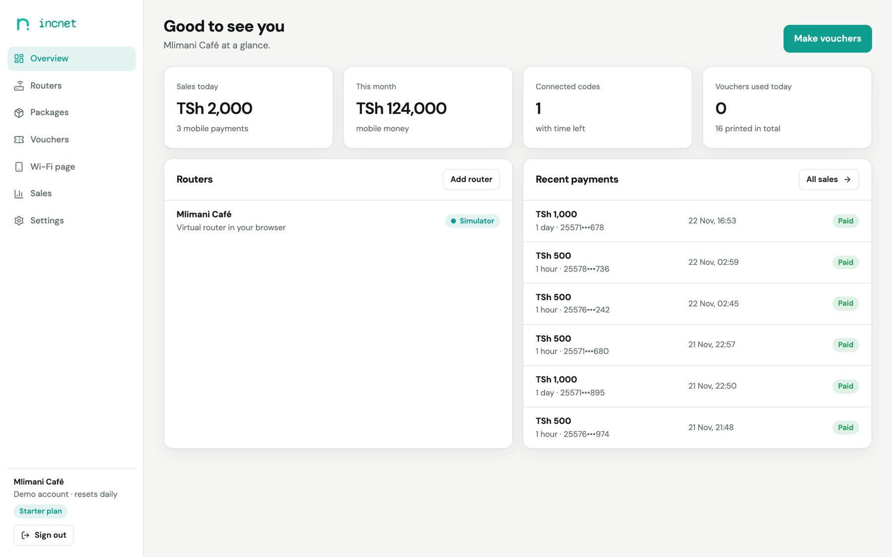

# incnet

Open-source hotspot billing for **MikroTik, Raspberry Pi and OpenWrt**. Sell Wi-Fi packages at a café, hostel or shop with printed vouchers and mobile money (M-Pesa, Mixx by Yas, Airtel Money, Halotel). You set up the router with **one paste**.



Use the hosted version at **incnet.incpritech.com**, or run it yourself on your own server and domain. It's the same software either way.

## What it does

- **Live demo and simulator.** Try everything in the browser with a virtual router, a virtual phone and test payments where no money moves. In cloud mode, a "Try the live demo" button creates a throwaway workspace that is deleted after 24 hours.
- **Raspberry Pi and OpenWrt.** One command turns a Pi or an OpenWrt router into the hotspot, using [openNDS](https://opennds.readthedocs.io). See [docs/raspberry-pi-gateway.md](docs/raspberry-pi-gateway.md).
- **Wi-Fi page designer.** Choose from five templates (Modern, Classic, Bold, Minimal, Photo), then add your logo, colours, a background photo, a headline, terms of use and a default language. A live phone preview shows each change.
- **Voucher designer.** Choose from four print templates (Classic, Ticket, Card, Minimal), with an optional QR code that opens the Wi-Fi page with the code filled in.
- **Per-router control.** Vouchers are made for one router and one package. Packages can be sold everywhere or at a single router.

- **One-paste router setup.** Add a venue, and incnet writes a RouterOS script that creates the hotspot bridge, DHCP, NAT, walled garden, login page and a sync job. The script is safe to paste again.
- **No VPN or public IP.** The router calls incnet every few seconds over HTTPS. It works behind ISP NAT and on mobile data links.
- **Self-healing.** After a reboot, the router reloads its active codes. If a hotspot reset replaces the login page, incnet puts it back.
- **Packages** with price, duration, speed, data cap and devices per code.
- **Vouchers**: make up to 500 at a time and print them on a cut-out sheet. Time starts on first use.
- **Mobile money** through [incpesa](https://incpritech.com/incpesa) or [Snippe](https://snippe.sh). The customer pays with their PIN and is logged in automatically. They also get a code so they can reconnect later.
- **Customer page** in English and Swahili. It uses system fonts only, because phones can't reach font services before they log in.
- **Dashboard**: sales, connected codes, router status, payments and code search.

## How it works

```
Phone ──Wi-Fi──> Access point ──> MikroTik hotspot ──(login page)──> incnet /p/<venue>
                                       ▲                               │
                                       └──── sync every 4 s (HTTPS) ───┘
```

1. A phone joins the Wi-Fi. The router's `login.html` sends it to `https://<your incnet>/p/<venue>`, along with its MAC address and the router's login URL.
2. The customer enters a voucher or pays by phone. incnet marks the code active.
3. On its next check-in, the router receives the code as a hotspot user, with the package's speed, time and data limits.
4. The page sends the phone to the router's own login URL with the code. The router lets it online.
5. When the time runs out or you cancel a code, the router removes the user and disconnects it on the next sync.

## Self-hosting

One command on a Raspberry Pi or a VPS. It sets up Docker, Postgres and automatic HTTPS:

```bash
curl -fsSL https://raw.githubusercontent.com/depriver-tech/incnet/main/scripts/install.sh | sudo DOMAIN=wifi.example.com bash
```

Shared hosting (cPanel) and manual setups are covered in [docs/self-hosting.md](docs/self-hosting.md). The steps below show the manual Docker route.

You need:

- A Linux server with Docker
- A domain pointing at the server
- HTTPS in front of it (Caddy is the simplest)

```bash
git clone https://github.com/depriver-tech/incnet.git
cd incnet
cp .env.example .env
# Edit .env: set APP_URL to your https address, and APP_SECRET to the output of: openssl rand -base64 48
docker compose up -d
```

Then open your domain and create the first account. It becomes the server owner, and sign-up closes after it. Set `ALLOW_SIGNUP=true` to let others register.

Example Caddy config:

```
wifi.example.com {
  reverse_proxy localhost:3000
}
```

`APP_URL` **must** be reachable from the internet over HTTPS with a public certificate, such as Let's Encrypt. Routers and payment providers call it, and RouterOS checks the certificate.

### Without Docker

You need Node.js 22+ and Postgres 14+.

```bash
npm install
cp .env.example .env    # set DATABASE_URL, APP_URL, APP_SECRET
npm run db:push
npm run build && npm start
```

## Router requirements

- MikroTik on **RouterOS 7**. It has been checked against the 7.19 command set. Any model works, including hAP, RB5009 and CCR.
- Access points of any brand, set to AP or bridge mode with DHCP off, cabled to the ports you choose.
- On models with device-mode restrictions, such as RB5009 on 7.17+, enable the hotspot once with `/system device-mode update hotspot=yes`, then confirm it with the button or a power-cycle. The script detects this and tells you.

To remove incnet from a router, delete the `incnet` hotspot server, the `incnet-sync` scheduler and script, and the `incnet-bridge` bridge.

## Payments

| Provider | Who it's for | Keys |
|---|---|---|
| Test mode | Trying incnet out. Payments complete after about 6 seconds and no money moves | — |
| incpesa | Anyone with an incpesa merchant account. Money settles to your incpesa balance. | `ip_live_…` API key |
| Snippe | Operators with their own Snippe account | `snp_…` API key and `whsec_…` webhook secret |
| None | Vouchers only | — |

Add the keys in **Settings → Mobile money**. They are encrypted at rest with `APP_SECRET`. A webhook alone never unlocks anything: incnet always re-reads the payment from the provider with your key first. It also polls while the customer waits, so payments complete even when webhooks can't reach your server.

## Hosted mode (SaaS)

Set `INCNET_CLOUD=true` to run incnet as a service for many businesses. This mode:

- Allows open sign-up
- Applies plan limits on routers (`PLANS` in `lib/config.ts`)
- Shows the **Platform** page to the first account, listing every workspace

## Development

```bash
docker run -d --name incnet-db -e POSTGRES_PASSWORD=incnet -e POSTGRES_USER=incnet -e POSTGRES_DB=incnet -p 5432:5432 postgres:17-alpine
cp .env.example .env    # APP_URL=http://localhost:3000
npm install && npm run db:push && npm run dev
```

The code lives here:

| Path | What |
|---|---|
| `lib/routeros.ts` | Everything sent to routers: the setup script, login page and sync script |
| `lib/sync.ts` | The router check-in |
| `lib/access.ts` | Voucher redemption and payment settlement |
| `lib/payments/` | Provider adapters. Add a provider by implementing `PaymentProvider` |
| `app/p/[slug]` | The customer page |

## License

[AGPL-3.0](LICENSE). You may use, change and self-host incnet freely. If you offer a modified version to others as a network service, you must publish your changes under the same license.
